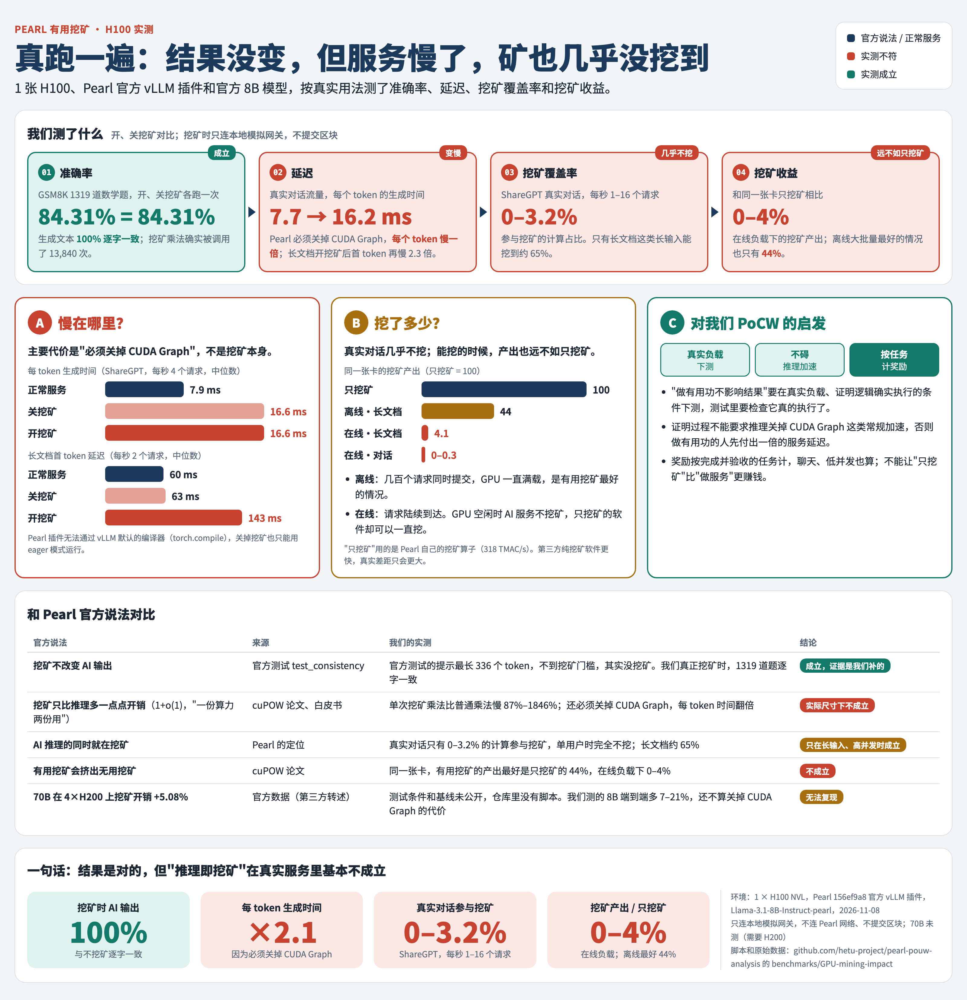

# GPU 实测：挖矿对 AI 服务的影响

在一张 H100 上实测 Pearl 官方 vLLM 插件开着挖矿时，AI 服务的结果、延迟、算力和收益会受什么影响。



| 环境 | |
|---|---|
| GPU | 1 × NVIDIA H100 NVL（94 GB），驱动 595.91.07，CUDA 13.2（vast.ai 租用，2026-11-08） |
| Pearl | `156ef9a8`，按 `miner/README.md` 用 `uv sync --package vllm-miner` 安装；vLLM 0.20.2，torch 2.11.0+cu130 |
| 模型 | `pearl-ai/Llama-3.1-8B-Instruct-pearl`，Hugging Face 版本 `5dcb348a` |
| 安全 | 网关只加载 Pearl 测试自带的模拟区块模板（`miner/conftest.py`），`MINER_SKIP_BLOCK_SUBMISSION=true`，不连节点、不提交区块 |

## 结论

1. **挖矿不改变 AI 输出。** GSM8K 1319 题开、关挖矿准确率都是 84.31%，生成文本 100% 逐字一致；单个矩阵乘法去噪后与普通乘法逐位相同。详见 P05。
2. **单次挖矿乘法的开销远高于 2r/m 估算。** 每次调用有约 0.7–1.2 ms 的固定开销，m=1024 时比普通乘法慢 4–18 倍，m=8192 时最大的层仍慢 87%。2r/m 只算了给权重加噪声，实际还有权重复制、Merkle 哈希、加噪乘法本身变慢和 CPU 端准备。
3. **对用户延迟影响最大的是"必须关掉 CUDA Graph"，不是挖矿本身。** Pearl 插件在这个版本无法通过 vLLM 默认的 torch.compile，只能 eager 运行；eager 让每个 token 的生成时间从约 8 ms 变成约 16 ms，对话的端到端延迟翻倍。而这类负载下挖矿几乎不发生。
4. **真实对话流量几乎不挖。** ShareGPT 请求按 1、4、16 个/秒陆续到达时，参与挖矿的线性层计算是 0%、0%、3.2%，与 P02 的仿真（0–5%）一致。长文档负载约 65%，但首 token 延迟增加一倍以上（60 → 140 ms）。
5. **有用挖矿的产出远低于纯挖矿。** 同一张卡只做挖矿，用 Pearl 自己的挖矿算子能挖 318 TMAC/s；作为 AI 服务时，在线负载下只挖到其 0–4%，离线大批量也只有 15–44%。

## 测试与结果

### 1. 准确率（P05）

程序：[`../P05-result-accuracy/gpu/p05_gpu_check.py`](../P05-result-accuracy/gpu/p05_gpu_check.py)。GSM8K 全部 1319 题一次提交，`max_num_seqs=1024`，贪心解码，只改 `MINER_NO_MINING`，并统计 `pearl_gemm_noisy` 的实际调用次数。

| | 关挖矿 | 开挖矿 |
|---|---|---|
| 准确率 | 84.31% | 84.31% |
| 挖矿乘法调用次数 | 0 | 13,840（最小 m = 1024） |
| 生成文本逐字相同 | 100% | |

输出：[`../P05-result-accuracy/results/reference-gpu-compare.txt`](../P05-result-accuracy/results/reference-gpu-compare.txt)，逐题结果在同目录的 `gpu-mining-*.json`。

### 2. 单次挖矿乘法的开销

程序：[`kernel_overhead.py`](kernel_overhead.py)，直接调用插件用的 `pearl_gemm_noisy` 和 `pearl_gemm_vanilla`（绕过 m ≥ 1024 的门槛），8B 模型三种可挖层的真实形状，CUDA 事件计时取中位数。

额外开销 = 挖矿乘法耗时 ÷ 普通乘法耗时 − 1：

| m | qkv_proj | o_proj | gate_up_proj | 2r/m 估算 |
|---|---|---|---|---|
| 256 | +2044% | +1891% | +1509% | 100% |
| 1024 | +1216% | +1845% | +435% | 25% |
| 4096 | +412% | +606% | +142% | 6% |
| 8192 | +245% | +344% | +87% | 3% |

所有形状下挖矿乘法的输出与普通乘法逐位相同。结果：[`results/kernel_overhead.json`](results/kernel_overhead.json)。

开销去向（[`kernel_breakdown.py`](kernel_breakdown.py)，torch.profiler，gate_up_proj，m = 4096）：

| | 耗时（每次调用） |
|---|---|
| 普通乘法：GPU 计算 | 1.08 ms |
| 挖矿乘法：GPU 计算合计 | 1.96 ms |
| 　其中 加噪乘法（含去噪、开奖） | 1.29 ms |
| 　其中 为哈希把权重整体复制一份（`B.to(torch.uint8)`） | 0.26 ms |
| 　其中 给权重加噪声 | 0.16 ms |
| 　其中 权重的 Merkle 哈希 | 0.16 ms |
| 挖矿乘法：GPU 等待 CPU（Python 准备、主机到设备的同步拷贝） | 0.33 ms |

小矩阵（o_proj 等）的挖矿开销主要是 CPU 端的 0.6–0.7 ms 固定时间。完整输出：[`results/kernel_breakdown.txt`](results/kernel_breakdown.txt)。

### 3. 延迟、吞吐、功耗：离线批量

程序：[`serving_impact.py`](serving_impact.py)。三种配置：

| 配置 | 含义 |
|---|---|
| graph | 关挖矿，解码步用 CUDA Graph。vLLM 默认的 torch.compile 在插件的量化内核上报错（`torch._dynamo.exc.Unsupported`），所以关闭编译、只录解码步（`FULL_DECODE_ONLY`）。这是 Pearl 模型能达到的最接近正常服务的配置 |
| eager | 关挖矿，`--enforce-eager`（Pearl 要求） |
| eager_mine | 开挖矿，`--enforce-eager`（Pearl 的挖矿配置） |

随机 token 提示、忽略 EOS，三种配置做完全相同的工作；请求一次性全部提交，首 token 延迟（TTFT）包含排队时间。

| 负载 | 指标 | graph | eager | eager_mine |
|---|---|---|---|---|
| 单用户（5 个请求依次执行，输入 200、输出 256） | 每 token 时间（TPOT）p50 | 7.6 ms | 16.1 ms | 16.1 ms |
| | 挖矿占线性层计算 | — | — | 0% |
| 对话（512 个请求，输入 200、输出 256） | TTFT p50 | 1.79 s | 1.80 s | 2.28 s |
| | 总耗时 | 9.14 s | 9.30 s | 9.98 s |
| | 挖矿占线性层计算 | — | — | 30% |
| 长文档（256 个请求，输入 2000、输出 64） | TTFT p50 | 6.19 s | 6.17 s | 8.14 s |
| | 总耗时 | 14.37 s | 14.45 s | 17.42 s |
| | 挖矿占线性层计算 | — | — | 66% |
| | 平均功耗 | 375 W | 377 W | 392 W |

显存峰值三种配置都约 87.4–87.9 GB（KV cache 按 90% 预分配），挖矿多占约 64 MiB。完整表格：[`results/reference-serving-report.txt`](results/reference-serving-report.txt)。

### 4. 延迟和挖矿覆盖率：在线流量

程序：[`online_impact.py`](online_impact.py)。启动 `vllm serve`，用 `vllm bench serve` 按泊松到达发送请求；挖矿覆盖率由 [`recorder/sitecustomize.py`](recorder/sitecustomize.py) 在 vLLM 引擎进程里统计。

| 负载 | 到达速率 | TTFT p50（graph / eager / eager_mine） | TPOT p50 | 端到端 p50 | 挖矿占线性层计算 |
|---|---|---|---|---|---|
| ShareGPT 真实对话 | 1 个/秒 | 29 / 49 / 50 ms | 7.7 / 16.2 / 16.4 ms | 1.17 / 2.46 / 2.47 s | 0% |
| | 4 个/秒 | 30 / 51 / 52 ms | 7.9 / 16.6 / 16.6 ms | 1.43 / 2.94 / 2.96 s | 0% |
| | 16 个/秒 | 37 / 59 / 59 ms | 9.3 / 19.7 / 19.8 ms | 1.40 / 2.88 / 2.93 s | 3.2% |
| 长文档（输入 2000、输出 64） | 0.5 个/秒 | 60 / 60 / 138 ms | 7.8 / 15.8 / 16.0 ms | 0.55 / 1.06 / 1.15 s | 65% |
| | 2 个/秒 | 60 / 63 / 143 ms | 8.0 / 16.4 / 18.3 ms | 0.57 / 1.10 / 1.36 s | 64% |

所有请求都成功完成。逐项结果：[`results/online.json`](results/online.json)，`vllm bench` 原始输出在 [`results/online/`](results/online/)。

### 5. 有用挖矿 vs 纯挖矿的产出

出块收益与挖矿乘加次数成正比：每个 h×w 输出块是一张彩票，目标值按 h·w·k 放大（`zk-pow/src/v1/api/sanity_checks.rs:91`，网关的 `adjust_target`），所以 m×n×k 的乘法相当于 m·n·k 份彩票价值。下面用"每秒挖矿乘加次数"比较产出。

纯挖矿基线：[`pure_mining.py`](pure_mining.py) 循环调用插件同一个 `pearl_gemm_noisy`，每种形状 20 秒。第三方专用挖矿软件可能更快，所以这是纯挖矿的下限。

| 场景 | 挖矿产出 | 相对纯挖矿 |
|---|---|---|
| 纯挖矿（m=16384，n=16384，k=8192） | 318 TMAC/s | 100% |
| 离线批量：长文档 256 个同时提交 | 139 TMAC/s | 44% |
| 离线批量：对话 512 个同时提交 | 49 TMAC/s | 15% |
| 在线：长文档 2 个/秒 | 13.0 TMAC/s | 4.1% |
| 在线：长文档 0.5 个/秒 | 4.7 TMAC/s | 1.5% |
| 在线：ShareGPT 16 个/秒 | 1.0 TMAC/s | 0.3% |
| 在线：ShareGPT 1、4 个/秒 | 0 | 0% |

在线负载下 GPU 有大量空闲时间，AI 服务不会用它挖矿；纯挖矿软件则可以把这些时间全部用来挖。结果：[`results/pure_mining.json`](results/pure_mining.json)。

## 局限

- 只测了 8B 模型、一张 H100 NVL。70B 需要 H200 或多卡。
- graph 配置关闭了编译，原版 vLLM（开编译）可能更快，所以"关掉 CUDA Graph 的代价"可能被低估。
- 离线批量测试中请求同时提交，TTFT 包含排队；对话负载的 30% 覆盖率是同时提交造成的，真实流量见第 4 节。
- 在线测试每档 60–1000 个请求、约 1–2 分钟，ShareGPT 每次抽样相同（`--seed 0`）。
- 纯挖矿用的是 Pearl 插件的算子，不是第三方挖矿软件。

## 运行

在 H100/H200 上按 Pearl 的 `miner/README.md` 装好环境（`uv sync --package vllm-miner`），再装 `datasets`（注意保持 `huggingface-hub<2`，否则 transformers 无法导入）。以下命令在 Pearl 仓库根目录执行，`B` 指向本目录：

```bash
uv run --no-sync python $B/kernel_overhead.py --pearl . --out kernel_overhead.json
```

```bash
uv run --no-sync python $B/kernel_breakdown.py --pearl . --out kernel_breakdown.txt
```

```bash
for c in graph eager eager_mine; do uv run --no-sync python $B/serving_impact.py run --pearl . --config $c --out serve_$c.json; done
```

```bash
uv run --no-sync python $B/pure_mining.py --pearl . --out pure_mining.json
```

```bash
uv run --no-sync python $B/online_impact.py --pearl . --sharegpt ShareGPT_V3_unfiltered_cleaned_split.json --out online.json
```

ShareGPT 数据：`anon8231489123/ShareGPT_Vicuna_unfiltered` 的 `ShareGPT_V3_unfiltered_cleaned_split.json`。整套测试约 2 GPU 小时。
