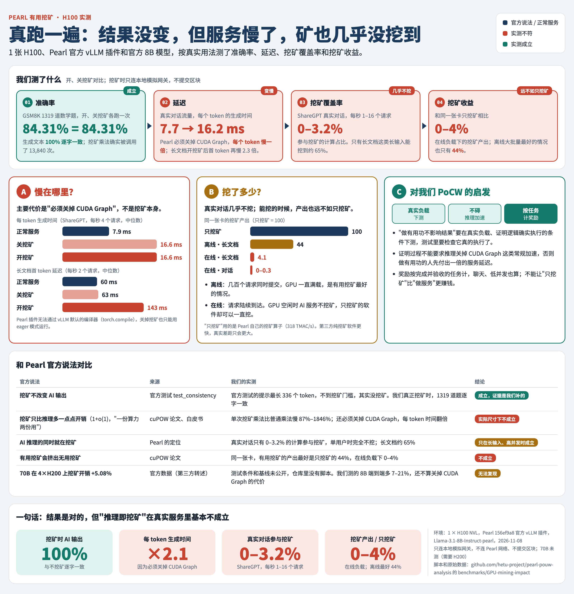

# Pearl 挖矿对 AI 服务影响的 H100 实测报告

**测试日期**：2026-11-08 ｜ **硬件**：1 张 NVIDIA H100 NVL ｜ **对象**：Pearl 官方 vLLM 挖矿插件（代码版本 `156ef9a8`）+ 官方模型 `Llama-3.1-8B-Instruct-pearl`
**脚本和原始数据**：[`benchmarks/GPU-mining-impact`](../benchmarks/GPU-mining-impact)、[`benchmarks/P05-result-accuracy`](../benchmarks/P05-result-accuracy)



---

## 一、这个测试测什么

Pearl 的核心卖点是"有用挖矿"：GPU 在做 AI 推理的同时顺便挖矿，"一份算力两份用"。这次测试在真实的 H100 上运行 Pearl 官方的挖矿软件，回答四个问题：

| 问题 | 为什么要问 | 对应问题报告 |
|---|---|---|
| 1. 开着挖矿，AI 的回答还准不准？ | 官方声称挖矿不影响结果，但官方的测试其实没有真正挖过矿 | P05 |
| 2. 开着挖矿，AI 服务慢了多少？ | 论文和白皮书说额外开销"很小"（1+o(1)），我们要看实际数字 | P02、P03 |
| 3. 真实使用时，有多少计算参与了挖矿？ | 插件一步不到 1024 个 token 就不挖，我们之前只做过仿真 | P02 |
| 4. 边做 AI 边挖矿，和只挖矿相比收益差多少？ | 如果只挖矿更赚钱，理性矿工就不会做 AI | P03 |

另外两项辅助测量：单次挖矿乘法的开销（解释问题 2 的原因），显存和功耗。

**一句话结论**：挖矿不改变 AI 的结果（问题 1 成立）；但 Pearl 要求关掉推理加速，服务慢一倍（问题 2）；真实对话只有 0–3.2% 的计算参与挖矿（问题 3）；挖矿收益只有只挖矿的 0–44%（问题 4）。

---

## 二、测试环境

| 项目 | 内容 |
|---|---|
| GPU | 1 × NVIDIA H100 NVL（94 GB 显存），驱动 595.91.07，CUDA 13.2；vast.ai 租用 |
| CPU / 内存 | 40 核 / 314 GB |
| Pearl | `github.com/pearl-research-labs/pearl`，commit `156ef9a8eb9d`（与问题分析使用的版本相同） |
| 安装方式 | 按 Pearl 官方 `miner/README.md`：`uv sync --package vllm-miner`，挖矿内核在本机编译 |
| 推理引擎 | vLLM 0.20.2，PyTorch 2.11.0（CUDA 13.0），均由 Pearl 的依赖锁文件决定 |
| 模型 | `pearl-ai/Llama-3.1-8B-Instruct-pearl`，Hugging Face 版本 `5dcb348a`（Pearl 官方发布的 7 位量化模型，官方测试也用它） |
| 安装验证 | Pearl 自带的挖矿内核单元测试：4147 个通过，144 个跳过，0 个失败 |

**安全措施**：挖矿需要一个"网关"提供区块模板。我们用的是 Pearl 自己测试代码里的模拟网关和模拟区块模板（`miner/conftest.py`），并设置 `MINER_SKIP_BLOCK_SUBMISSION=true`。**全程不连接 Pearl 网络，不提交任何区块，不产生任何链上收益。** 挖矿计算本身与真实挖矿完全相同。

---

## 三、测试方法的基本原则

### 1. 对照实验：只改一个开关

每项测试都把同一个模型、同一批输入跑两遍或三遍，中间只改一个设置：

| 配置 | 挖矿 | CUDA Graph | 说明 |
|---|---|---|---|
| **正常服务** | 关 | 开（只用于生成回答的步骤） | Pearl 模型能达到的最接近正常 AI 服务的配置 |
| **关挖矿** | 关 | 关（eager 模式） | Pearl 要求的运行方式，但不挖矿 |
| **开挖矿** | 开 | 关（eager 模式） | Pearl 官方的挖矿配置 |

- "关挖矿 → 开挖矿"的差别 = **挖矿本身**的代价；
- "正常服务 → 关挖矿"的差别 = **为了能挖矿而关掉推理加速**的代价。

挖矿开关是 Pearl 自己的环境变量 `MINER_NO_MINING`。它只决定 7 位量化的层走"挖矿乘法"还是"普通乘法"（`vllm_kernels.py:207`），模型、量化方式、输入全都不变。

### 2. 确认挖矿真的发生了

官方测试的问题就在于没真正挖矿（P05）。所以我们在每个测试里都加了计数器：

- 把插件里的挖矿乘法 `pearl_gemm_noisy` 包一层，每调用一次就计数，并记录这次乘法的大小（m、n、k）；
- **开挖矿时调用次数必须大于 0，关挖矿时必须等于 0**，否则脚本直接报错退出，不出结果；
- 在线服务测试中，AI 服务运行在 vLLM 的独立进程里，我们通过 Python 的 `sitecustomize` 机制把同样的计数器注入那个进程（`recorder/sitecustomize.py`）。

### 3. 不改 Pearl 的代码

所有测试只调用 Pearl 自己的函数，计数器只是在外面包一层，不改变计算本身。

---

## 四、各项测试

### 测试 1：准确率（挖矿会不会改变 AI 的回答）

**要回答的问题**：开着挖矿和关着挖矿，AI 对同样的问题给出的答案是否一样、是否一样准。

**用什么数据**：GSM8K 小学数学应用题数据集（`openai/gsm8k`）的**全部 1319 道测试题**。每道题有标准答案（一个数字），这是大模型评测最常用的数据集之一。

**测试步骤**：

1. 启动 Pearl 的模拟网关；
2. 设置挖矿开关（第一次 `MINER_NO_MINING=true`，第二次 `false`），**每次单独启动一个新进程**，因为 Pearl 只在启动时读一次这个开关；
3. 加载模型，参数与 Pearl 官方测试一致：`enforce_eager=True`、注意力后端 `TRITON_ATTN`（Pearl 测试选它是因为结果可逐位复现）、`max_model_len=4096`、`max_num_seqs=1024`、随机种子 0；
4. 给挖矿乘法装上计数器；
5. 把 1319 道题**一次性全部提交**。这样每一步都有成百上千个 token，能超过 1024 的挖矿门槛，确保真的在挖矿；
6. 每道题的提示：用模型自带的对话模板，内容是"题目 + Solve the problem step by step. End with a final line of the form '#### <number>'."（请一步步解题，最后一行写"#### 答案"）；
7. 生成参数：**贪心解码**（temperature = 0，每次都选概率最高的词，结果是确定的，没有随机性），每道题最多生成 512 个 token；
8. 保存每道题的完整回答、提取出的答案、是否答对，以及挖矿乘法的调用次数；
9. 两次都跑完后，逐题比较。

**准确率怎么算**：

- **提取答案**：先在回答里找"#### 数字"；找不到，就取回答里**最后出现的那个数字**。去掉千分位逗号和末尾的句号，统一成数字格式（比如 "18.0" 和 "18" 视为相同）；
- **标准答案**：GSM8K 每道题的标准解答最后都有一行"#### 数字"，用同样的方法提取；
- **判对**：提取出的答案和标准答案**完全相等**才算对；
- **准确率** = 答对的题数 ÷ 1319。

举例（第 1 题，关于 Janet 卖鸡蛋）：标准答案是 18，模型回答的最后结论也是 18，判对。
答错的例子（关于 Josh 翻修房子）：标准答案是 70000，模型算成了 40000，判错。这是模型本身算错，开、关挖矿都错在同一处。

**结果**：

| | 关挖矿 | 开挖矿 |
|---|---|---|
| 答对题数 | 1112 / 1319 | 1112 / 1319 |
| 准确率 | **84.31%** | **84.31%** |
| 挖矿乘法调用次数 | 0 | **13,840**（每次 m ≥ 1024，共处理 2,564 万行） |
| 只在关挖矿时答对的题 | — | 0 |
| 只在开挖矿时答对的题 | — | 0 |
| **生成的完整回答逐字相同** | **1319 / 1319（100%）** | |

**怎么确定这个结论是可靠的**：

1. **最强的证据不是准确率，而是"逐字相同"**：1319 道题的完整回答，每个字都一样。这不依赖答案提取方法，也不依赖题目难度。只要挖矿改变了计算结果，哪怕只有一个数字的最后一位不同，贪心解码下也很可能在某处选出不同的词，回答就不会逐字相同；
2. **确认真的挖了**：开挖矿时挖矿乘法被调用了 13,840 次，关挖矿时是 0 次。这一点正是官方测试缺失的；
3. **单个乘法层面也一致**（见测试 2）：直接比较挖矿乘法和普通乘法的输出矩阵，所有尺寸下逐位相同；
4. **84.31% 这个数值本身是合理的**：作为参考，Meta 公布的原版 Llama-3.1-8B-Instruct 在 GSM8K 上是 84.5%（8 个示例 + 思维链）。我们用的是 Pearl 的 7 位量化版、零示例、自己的提示和评分方式，所以两个数字不能直接比较，只能说明量级正常。Pearl 的模型卡上没有给出 8B 模型的任何精度数据。

**需要说明的地方**：

- 只有 163 道题的回答按要求写了"#### 数字"，其余 1156 道靠"取最后一个数字"判分。这种评分方式比较宽松，可能把个别答错的题判对、或把答对的题判错，所以 84.31% 这个绝对值只是参考。**但两次运行用的是完全相同的评分方式，而且回答逐字相同，所以"挖矿不改变结果"的结论不受影响**；
- 只测了 8B 模型。70B 需要 H200 或多卡，没有测。

**结论**：挖矿不改变 AI 的输出。官方说法本身是对的，但官方的测试证明不了它，这次实测补上了证据。

---

### 测试 2：单次挖矿乘法的开销

**要回答的问题**：做一次挖矿乘法，比做一次普通乘法多花多少时间？我们之前按理论公式（2r/m，r = 128）估算，m = 1024 时约多 25%。

**测试步骤**：

1. 直接调用插件里的两个函数：挖矿乘法 `pearl_gemm_noisy`、普通乘法 `pearl_gemm_vanilla`。直接调用会绕过 1024 的门槛，所以门槛以下的大小也能测；
2. 矩阵大小用 8B 模型三种能挖矿的层的真实形状：qkv_proj（6144 × 4096）、o_proj（4096 × 4096）、gate_up_proj（28672 × 4096）；
3. m（这一步的 token 数）取 256、512、1024、2048、4096、8192；
4. 每个组合先预热 5 次，再计时 30 次，用 GPU 计时器（CUDA Event），取中位数；
5. 同时检查两种乘法的输出是否逐位相同；
6. 再用 PyTorch 的性能分析器（torch.profiler）拆开看挖矿乘法的时间花在哪些 GPU 内核上。

**结果**：额外开销 = 挖矿乘法耗时 ÷ 普通乘法耗时 − 1

| m | qkv_proj | o_proj | gate_up_proj | 理论估算 2r/m |
|---|---|---|---|---|
| 1024（插件门槛） | +1216% | +1845% | +435% | 25% |
| 4096 | +412% | +606% | +142% | 6% |
| 8192 | +245% | +344% | +87% | 3% |

时间去向（gate_up_proj，m = 4096，每次调用）：普通乘法 1.08 ms；挖矿乘法 GPU 计算 1.96 ms，其中加噪声乘法本身 1.29 ms、为算哈希把整份权重复制一遍 0.26 ms、给权重加噪声 0.16 ms、对权重算 Merkle 哈希 0.16 ms；另外 GPU 还要等 CPU 0.33 ms（Python 准备工作和数据拷贝）。

**结论**：实测开销是理论值的十几到几十倍。理论公式只算了"给权重加噪声"这一项，漏掉了复制权重、算哈希和 CPU 端的固定开销。所有尺寸下，挖矿乘法的输出都和普通乘法逐位相同。

---

### 测试 3：延迟和吞吐（离线批量）

**要回答的问题**：在三种配置下跑同样的任务，AI 服务慢了多少？

**测试步骤**：

1. 三种配置（正常服务 / 关挖矿 / 开挖矿）各启动一个新进程，跑同样的三种负载；
2. 输入用固定随机种子生成的随机 token，并忽略结束符（`ignore_eos`），保证三种配置生成的 token 数完全相同、做的计算量完全相同；
3. 三种负载：
   - **单用户**：5 个请求一个接一个地执行，输入 200 token、输出 256 token；
   - **对话**：512 个请求同时提交，输入 200、输出 256；
   - **长文档**：256 个请求同时提交，输入 2000、输出 64；
4. 记录：总耗时、吞吐（每秒输出多少 token）、首 token 延迟（TTFT）、每 token 生成时间（TPOT）；
5. 运行期间用 `nvidia-smi` 每秒记录一次功耗和显存。

**结果**（中位数）：

| 负载 | 指标 | 正常服务 | 关挖矿 | 开挖矿 |
|---|---|---|---|---|
| 单用户 | 每 token 时间 | 7.6 ms | 16.1 ms | 16.1 ms |
| | 挖矿占比 | — | — | 0%（一次都没挖） |
| 对话（512 个同时） | 首 token 延迟 | 1.79 s | 1.80 s | 2.28 s |
| | 总耗时 | 9.14 s | 9.30 s | 9.98 s |
| 长文档（256 个同时） | 首 token 延迟 | 6.19 s | 6.17 s | 8.14 s |
| | 总耗时 | 14.37 s | 14.45 s | 17.42 s（+21%） |

**意外发现**：Pearl 插件无法通过 vLLM 默认的编译器 torch.compile，**关掉挖矿也不行**（报错 `torch._dynamo.exc.Unsupported`）。所以"正常服务"这一列是我们关掉编译、只给生成回答的步骤开 CUDA Graph 得到的，真正的原版 vLLM 可能更快。

**结论**：单用户时，变慢的原因全部是"必须关掉 CUDA Graph"，而且这时根本不挖矿。高并发、长输入时，挖矿本身让总耗时增加约 21%。

---

### 测试 4：真实流量下的挖矿比例和延迟

**要回答的问题**：测试 3 是所有请求同时提交，偏理想。真实用户是陆续到来的，这时有多少计算参与了挖矿？

**测试步骤**：

1. 用 Pearl 插件启动标准的 AI 服务接口（`vllm serve`），和真实部署一样；
2. 用 vLLM 自带的压测工具（`vllm bench serve`）按泊松分布发送请求，模拟用户随机到达；
3. 两类负载：
   - **ShareGPT 真实对话**：真实用户和 ChatGPT 的对话记录，问题和回答长度都来自真实数据；每秒 1、4、16 个请求，分别发 120、400、1000 个；
   - **长文档**：输入 2000 token、输出 64 token；每秒 0.5、2 个请求，分别发 60、200 个；
4. 三种配置各跑一遍，所有请求都要求成功完成；
5. 挖矿比例：在 AI 服务进程里统计每次可挖层调用的 (m, n, k) 和是否挖矿，**挖矿比例 = 被挖的乘加次数 ÷ 全部线性层的乘加次数**。

**结果**（中位数，三个数字依次是 正常服务 / 关挖矿 / 开挖矿）：

| 负载 | 每秒请求数 | 首 token 延迟 | 每 token 时间 | 挖矿比例 |
|---|---|---|---|---|
| ShareGPT 真实对话 | 1 | 29 / 49 / 50 ms | 7.7 / 16.2 / 16.4 ms | **0%** |
| | 4 | 30 / 51 / 52 ms | 7.9 / 16.6 / 16.6 ms | **0%** |
| | 16 | 37 / 59 / 59 ms | 9.3 / 19.7 / 19.8 ms | **3.2%** |
| 长文档 | 0.5 | 60 / 60 / 138 ms | 7.8 / 15.8 / 16.0 ms | 65% |
| | 2 | 60 / 63 / 143 ms | 8.0 / 16.4 / 18.3 ms | 64% |

**结论**：
- 真实对话几乎不挖矿，与我们之前仿真的 0–5% 一致；
- 所有负载下，用户感受到的生成速度都慢了一倍（约 8 ms → 16 ms），原因是 Pearl 要求关掉 CUDA Graph；
- 长文档能挖到约 65%（理论上限 67%），但开挖矿后首 token 延迟从 60 ms 涨到约 140 ms。

---

### 测试 5：边做 AI 边挖矿 vs 只挖矿的收益

**要回答的问题**：同一张卡，用来做 AI 服务顺便挖矿，和什么都不做只挖矿，挖矿收益差多少？

**怎么比较收益**：Pearl 的出块奖励与"挖矿乘法做了多少次乘加"成正比。每个输出小块是一张彩票，中奖门槛按小块大小 × k 放大（`zk-pow/src/v1/api/sanity_checks.rs:91`），所以一次 m × n × k 的挖矿乘法相当于 m·n·k 份彩票价值，与这次乘法有没有用无关。因此我们用"**每秒挖矿乘加次数**"（TMAC/s，每秒万亿次乘加）衡量挖矿收益。

**测试步骤**：

1. **只挖矿**：循环调用 Pearl 自己的挖矿乘法，每种矩阵形状连续跑 20 秒，取最快的一种：**318 TMAC/s**。这个算子每次仍会重新加噪声和去噪声，真正的纯挖矿软件可以省掉这些，会更快，所以 318 是只挖矿的下限；
2. **边做 AI 边挖矿**：取测试 3 和测试 4 中实际统计到的挖矿乘加次数，除以运行时间；
3. 两者相除。

**结果**：

| 场景 | 挖矿收益 | 相对只挖矿 |
|---|---|---|
| 只挖矿 | 318 TMAC/s | 100% |
| 离线：256 个长文档同时提交（最好的情况） | 139 TMAC/s | **44%** |
| 离线：512 个对话同时提交 | 49 TMAC/s | 15% |
| 在线：长文档，每秒 2 个 | 13 TMAC/s | 4.1% |
| 在线：长文档，每秒 0.5 个 | 4.7 TMAC/s | 1.5% |
| 在线：真实对话，每秒 16 个 | 1.0 TMAC/s | 0.3% |
| 在线：真实对话，每秒 1、4 个 | 0 | 0% |

**结论**：最好的情况下也只有只挖矿的 44%（与仿真的 46–57% 相符），真实在线服务时 0–4%。在线服务时 GPU 有大量空闲时间，AI 服务不会用它挖矿，只挖矿的软件却可以一直挖。

---

### 测试 6：显存和功耗

在测试 3 运行期间，用 `nvidia-smi` 每秒采样一次：
- **显存**：挖矿多占约 64 MiB，可以忽略（vLLM 本身按 90% 预分配显存）；
- **功耗**：长文档负载下从 377 W 升到 392 W（+4%），其他负载基本不变。

---

## 五、和 Pearl 官方说法的对比

| 官方说法 | 来源 | 我们的实测 | 结论 |
|---|---|---|---|
| 挖矿不改变 AI 输出 | 官方测试 `test_consistency` | 官方测试的提示最长 336 个 token，不到挖矿门槛，其实没挖矿。我们真正挖矿时，1319 道题逐字一致 | **成立**，但证据是我们补的 |
| 挖矿只比推理多一点点开销（1+o(1)，"一份算力两份用"） | cuPOW 论文、白皮书 | 单次挖矿乘法慢 87%–1846%；还必须关掉 CUDA Graph，每 token 时间翻倍 | **实际尺寸下不成立** |
| AI 推理的同时就在挖矿 | Pearl 的定位 | 真实对话只有 0–3.2% 的计算参与挖矿；单用户时完全不挖 | **只在长输入、高并发时成立** |
| 有用挖矿会挤出无用挖矿 | cuPOW 论文 | 同一张卡，有用挖矿收益最好是只挖矿的 44%，在线 0–4% | **不成立** |
| 70B 在 4×H200 上挖矿开销 +5.08% | 官方数据（第三方转述） | 测试条件和基线未公开，仓库里没有脚本。我们测的 8B 端到端多 7–21%，还不算关掉 CUDA Graph 的代价 | **无法复现** |

---

## 六、局限

1. 只测了 8B 模型和一张 H100 NVL；70B 需要 H200 或多卡；
2. "正常服务"配置关闭了编译器，原版 vLLM 可能更快，所以"关掉 CUDA Graph 的代价"可能被低估；
3. 测试 3 的请求同时提交，首 token 延迟包含排队时间；真实流量以测试 4 为准；
4. 测试 4 每档 1–2 分钟、60–1000 个请求；
5. 准确率的答案提取比较宽松（见测试 1），绝对值只作参考；
6. "只挖矿"用的是 Pearl 插件的算子，不是第三方纯挖矿软件，真实差距会更大。

---

## 七、怎么复现

按 Pearl 的 `miner/README.md` 在 H100/H200 上装好环境（`uv sync --package vllm-miner`），再安装 `datasets`（保持 `huggingface-hub<2`）。在 Pearl 仓库根目录运行，`B` 指向本仓库的 `benchmarks/GPU-mining-impact`，`P` 指向 `benchmarks/P05-result-accuracy/gpu`：

```bash
uv run --no-sync python $P/p05_gpu_check.py run --pearl . --mode no_mining --out off.json
```

```bash
uv run --no-sync python $P/p05_gpu_check.py run --pearl . --mode mining --out on.json
```

```bash
uv run --no-sync python $P/p05_gpu_check.py compare off.json on.json
```

测试 2–6 的命令见 [`benchmarks/GPU-mining-impact/README.md`](../benchmarks/GPU-mining-impact/README.md)。整套测试约 2 GPU 小时。

---

## 附：名词解释

| 名词 | 含义 |
|---|---|
| token | 模型处理文字的基本单位，大约相当于一个英文单词或一两个汉字 |
| m | 一步计算中处理的 token 总数。读输入时等于输入长度；生成回答时等于同时在生成的用户数 |
| 1024 门槛 | Pearl 插件只在 m ≥ 1024 时挖矿 |
| 首 token 延迟（TTFT） | 从发出请求到收到第一个字的时间 |
| 每 token 时间（TPOT） | 生成回答时，每个字之间的间隔，决定用户看到文字"往外蹦"的速度 |
| CUDA Graph | vLLM 加速生成回答的技术：把一步的 GPU 操作预先录好，之后直接重放。Pearl 要求关掉它 |
| eager 模式 | 不用 CUDA Graph，每一步都现场执行 |
| 贪心解码 | 每次都选概率最高的下一个词，没有随机性，同样的输入一定得到同样的输出 |
| 乘加（MAC） | 一次乘法加一次加法，矩阵乘法的基本运算；TMAC/s 表示每秒万亿次 |
| GSM8K | 小学数学应用题数据集，测试集共 1319 道题，每道题有唯一的数字答案 |
| ShareGPT | 真实用户与 ChatGPT 的对话记录，常用来模拟真实聊天流量 |
