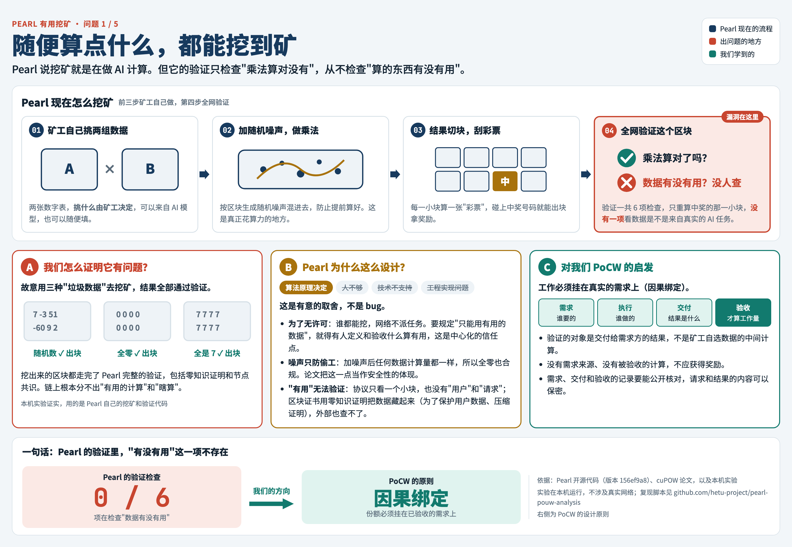
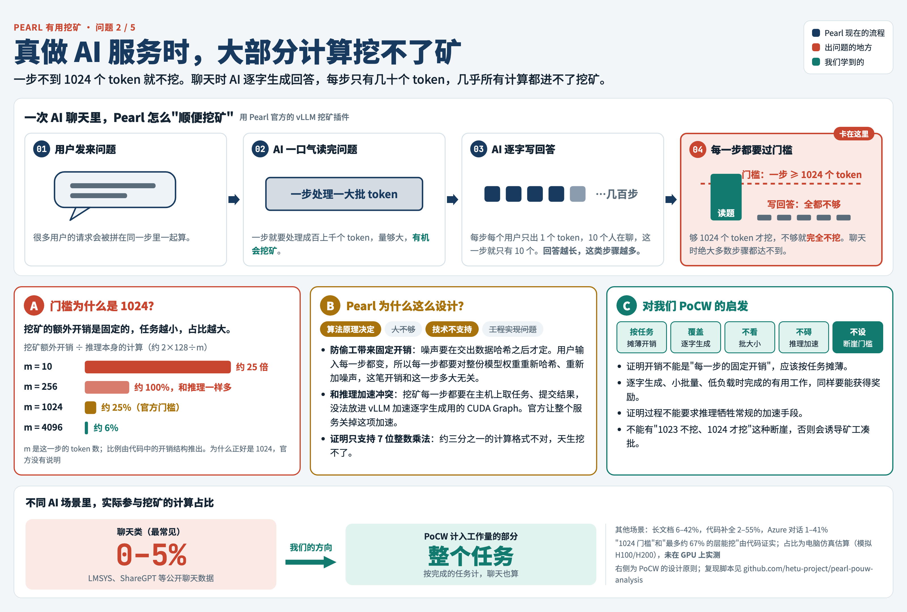
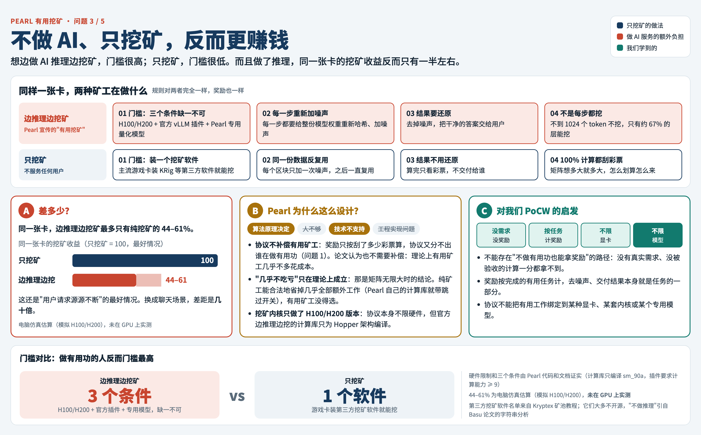
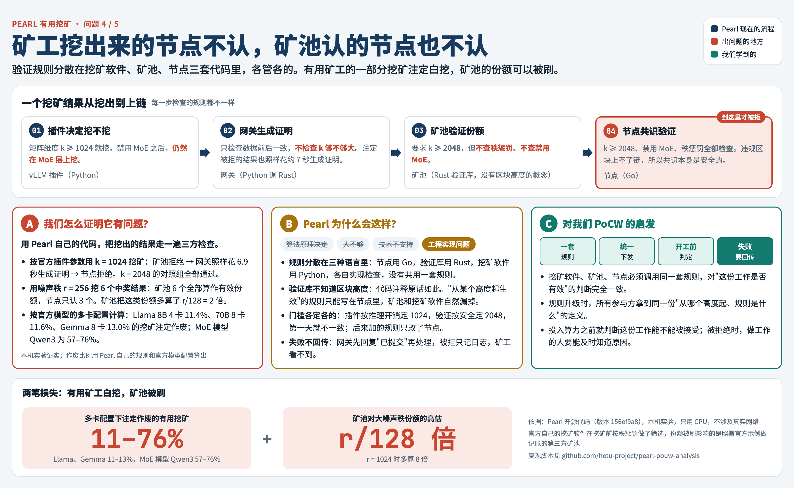
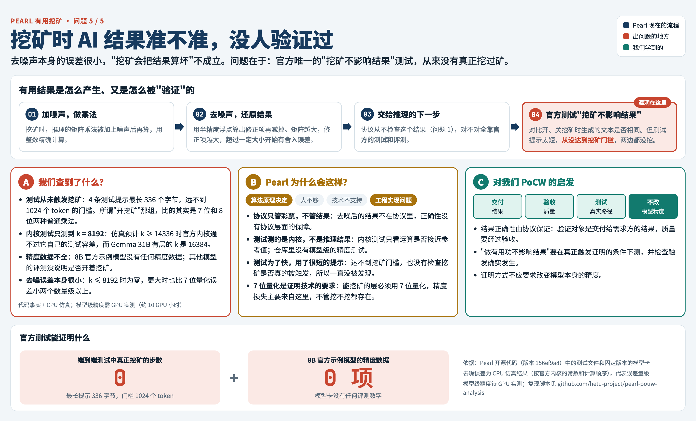

# Pearl PoUW 问题分析

本文档汇总我们对 Pearl 有用工作量证明（PoUW，即 cuPOW 协议）的分析，共 5 个问题。每个问题按同一格式写：问题是什么、原来的算法是什么、我们怎么验证的、benchmark 结果、会影响什么、Pearl 为什么这么设计，以及对 PoCW 设计的启发。

下面 5 张图各概括一个问题：Pearl 的流程在哪一步出了问题、我们怎么证明的、Pearl 为什么这么设计、对 PoCW 的启发。需要细节，再看后面各节和每个问题的详细报告；全文结论见最后一节"总结"。

## 五个问题一览

**P01　随便算点什么，都能挖到矿**：验证只查乘法算对没有，不查算的东西有没有用，全零矩阵也能出块。



**P02　真做 AI 服务时，大部分计算挖不了矿**：一步不到 1024 个 token 就不挖，聊天类负载只有约 0–5% 的计算参与挖矿。



**P03　不做 AI、只挖矿，反而更赚钱**：边推理边挖矿要 H100/H200、官方插件、专用模型三个条件，收益最多只有同卡纯挖矿的 44–61%。



**P04　矿工挖出来的节点不认，矿池认的节点也不认**：三方规则不一致，多卡配置下 11–76% 的有用挖矿注定作废，矿池份额被高估 r/128 倍。



**P05　挖矿时 AI 结果准不准，没人验证过**：去噪误差本身很小，但官方"挖矿不影响结果"的测试从未真正挖过矿。



---

## 一、Benchmark 项目：pearl-pouw-analysis

### 1. 作用

`pearl-pouw-analysis` 是我们为这次研究建的公开仓库，用来让**任何人都能独立核对我们的结论**：

1. **放证据**：每个问题都写明 Pearl 源码中的具体位置（文件、行号），以及实验的原始日志；
2. **能复现**：每个经实验证实的问题都配一个 benchmark 程序，直接调用 Pearl 自己的函数，在固定版本的 Pearl 上一条命令就能重跑；
3. **不改 Pearl**：benchmark 只作为示例程序（example）复制进 Pearl 源码目录后编译，Pearl 自身代码一行不动，避免"改了代码才复现"的质疑。

### 2. 基本信息

| 项目 | 内容 |
|---|---|
| GitHub 地址 | https://github.com/hetu-project/pearl-pouw-analysis |
| 分支 | `main` |
| 可见性 | 公开 |
| 许可证 | MIT；benchmark 程序调用 Pearl 代码，附 Pearl 的 ISC 许可证（`benchmarks/LICENSE-PEARL`） |
| 研究对象 | [`pearl-research-labs/pearl`](https://github.com/pearl-research-labs/pearl) `master` 分支 @ [`156ef9a8`](https://github.com/pearl-research-labs/pearl/commit/156ef9a8eb9dc7c74fab8c502598b8b53d4be7b1)（主网当前版本：int7 方案、证书 V3、秩惩罚已生效） |
| FP8 新方案 | Pearl 的 `fp8-scheme` 分支（撰写时未在任何网络启用，只做源码分析） |
| 研究时间 | 2026 年 10 月 |
| 依赖 | git；Rust **1.88.0**（1.87 编译不过 Pearl 的依赖）；Python 3.10+（只用于 `experiments/`，仅标准库）；零知识证明一步需要约 6 GB 空闲内存 |
| 参考实验机器 | Apple M4，16 GB 内存，macOS |

### 3. 目录结构

```
docs/
  problem-analysis.md   本文档：问题汇总分析
  pearl-algorithm.md    Pearl 挖矿与验证算法（伪代码 + 每个参数的含义）
  problems/             每个问题的详细报告
  images/               每个问题的概览图
  notes/                按组件写的源码研究笔记（01–08）
  methodology.md        研究方法、报告格式、严重程度定义
  references.md         论文与外部资料
benchmarks/
  P01-any-matrix/       每个问题一个目录：程序、运行脚本、参考结果
  P02-mining-coverage/
  P03-useful-vs-pure/
  P04-rule-mismatch/
  P05-result-accuracy/
experiments/            研究笔记引用的辅助实验脚本与输出
scripts/
  setup-pearl.sh        拉取固定版本的 Pearl 源码到 third_party/pearl
  fetch-papers.sh       下载论文（论文不随仓库分发）
```

### 4. 怎么复现

```bash
git clone https://github.com/hetu-project/pearl-pouw-analysis.git
```

```bash
cd pearl-pouw-analysis && ./scripts/setup-pearl.sh
```

```bash
./benchmarks/P01-any-matrix/run.sh
```

其他问题把目录名换成 `P02-mining-coverage`、`P03-useful-vs-pure`、`P04-rule-mismatch`、`P05-result-accuracy` 即可，每个 benchmark 目录的 README 写明了运行时间、内存和依赖。

`setup-pearl.sh` 会把 Pearl 固定版本拉到 `third_party/pearl`（不提交到 git）。已有 Pearl 源码的话，设置 `PEARL_DIR=/path/to/pearl` 即可复用，但必须是 `156ef9a8` 这个版本，本仓库所有行号都以它为准。

### 5. 严重程度

| 等级 | 含义 |
|---|---|
| 致命 | 协议的核心承诺不成立（如"有用"或"工作量不可伪造"），或可直接导致资金损失、链停止 |
| 严重 | 可被利用获得 10% 以上的不当收益，或显著削弱安全性、去中心化 |
| 中等 | 有实际影响，但可以缓解，或只影响部分场景 |
| 轻微 | 工程瑕疵、文档不一致，没有直接利用路径 |

### 6. 原则

- 只在本机和 Pearl 源码副本上实验，**不在任何真实网络上测试**；
- 涉及正在运行的网络、且有可利用细节的问题，先通过 Pearl 的安全渠道通知，再公开细节。

---

## 二、问题总览

| 编号 | 问题 | 严重程度 | 结论 | 详细报告 | Benchmark |
|---|---|---|---|---|---|
| P01 | 任意矩阵（包括全零矩阵）都能挖矿出块，"有用"无法验证 | 致命 | 成立（实验证实） | [P01](problems/P01-any-matrix-mines.md) | [P01-any-matrix](../benchmarks/P01-any-matrix) |
| P02 | 有用挖矿覆盖率低：单步 ≥1024 个 token 才挖，对话类负载只有约 0–5% 的推理计算参与挖矿 | 严重 | 成立（规则由代码证实；比例为 CPU 仿真估算，待 GPU 实测） | [P02](problems/P02-mining-coverage.md) | [P02-mining-coverage](../benchmarks/P02-mining-coverage) |
| P03 | 有用挖矿比纯挖矿更不划算：同一张卡上份额产出最多只有纯挖矿的 44–61%，官方软件只支持 H100/H200 | 严重 | 成立（开销结构由代码证实；比例为 CPU 仿真估算，待 GPU 实测） | [P03](problems/P03-useful-vs-pure.md) | [P03-useful-vs-pure](../benchmarks/P03-useful-vs-pure) |
| P04 | 矿工、矿池、共识三方的规则不一致：多卡配置下 11–19% 的有用挖矿注定作废，MoE 模型最多 76%；矿池份额被高估 r/128 倍 | 中等 | 成立（实验证实；作废比例由代码和官方配置算出） | [P04](problems/P04-rule-mismatch.md) | [P04-rule-mismatch](../benchmarks/P04-rule-mismatch) |
| P05 | 有用结果的正确性没有可信验证：官方"挖矿不影响结果"的端到端测试从未触发挖矿，内核测试只覆盖到 k=8192，8B 模型没有任何精度数据 | 中等 | 部分成立（去噪误差很小；"没有可信验证"由代码证实；模型级精度待 GPU 实测） | [P05](problems/P05-result-accuracy.md) | [P05-result-accuracy](../benchmarks/P05-result-accuracy) |


---

## 三、P01：任意矩阵都能挖矿出块，包括全零矩阵

**严重程度：致命** ｜ **结论：成立（本机实验证实）**
详细报告：[`docs/problems/P01-any-matrix-mines.md`](problems/P01-any-matrix-mines.md) ｜ Benchmark：[`benchmarks/P01-any-matrix`](../benchmarks/P01-any-matrix)

### 1. 问题是什么

Pearl 宣称挖矿用的是 AI 推理里的矩阵乘法，所以挖矿是"有用"的。但验证者**根本不检查矩阵是不是来自 AI 推理**：我们用随机数、全零、全是同一个常数的矩阵挖矿，生成的区块都通过了 Pearl 完整的共识验证。"有用"在协议里无法验证，也无法强制。

### 2. 原来的算法是什么

完整算法见 [`pearl-algorithm.md`](pearl-algorithm.md)。

**挖矿**：矿工自选矩阵 A（m×k）、B（k×n），元素为 [−64, 64] 的整数 → 对 A、B 做 Merkle 承诺 → 由区块头和承诺推导种子、生成低秩噪声 → 计算 (A+E_A)×(B+E_B)，每个 h×w 小块算一张彩票 → 彩票哈希低于难度目标即中奖，交出该小块用到的 h 行 A、w 列 B 及 Merkle 路径。

**验证**（`zk-pow/src/api/verify.rs:101-134`）：

| 步骤 | 检查内容 | 代码位置 |
|---|---|---|
| ① | Merkle 路径对得上承诺 | `:108` |
| ② | 参数在允许范围内 | `:111` |
| ③ | **每个元素在 [−64, 64] 之间** | `:114-118` |
| ④ | 由种子重新生成噪声 | `:124` |
| ⑤ | 重算中奖小块的彩票 | `:127` |
| ⑥ | 彩票哈希与难度目标比较 | `:130-131` |

- 对矩阵内容**唯一**的检查是第 ③ 步的数值范围；
- 验证者只重算一个小块，节点默认配置下占全部计算的 1/4096；
- 去噪后的 A×B（真正"有用"的输出）从不提交、不检查；
- 链上只公开 164 字节（`zk-pow/src/api/proof.rs:78-80`），连那 h 行、w 列都看不到；共识层（`node/blockchain/validate.go:529-560`）也不看矩阵内容；
- 附带发现：Pearl 官方的 CPU 挖矿函数 `try_mine_one`（`zk-pow/src/ffi/mine.rs:18-129`）用随机数生成 A、B，中奖即返回，**从不计算完整的 A×B**。

### 3. 我们怎么验证的

- 环境：Pearl `156ef9a8`（未修改）、Apple M4 16 GB、Rust 1.88.0；
- 参数：节点默认配置 m=256、n=512、k=2048、r=128、小块 4×8；V3 加盐种子；低难度 nbits=0x1E01FFFF（只为几秒出结果，不影响结论）；
- 4 组矩阵：随机数 [−64, 64]、全零、全 7、全 −64；
- 每组走完区块上链的全部 5 道检查：`mine()` → `verify_plain_proof`（矿池验份额）→ `check_cert_version_eligible(3)` → `zk_prove_plain_proof` + `verify_block`（节点共识路径）→ `check_rank_penalty`。

### 4. Benchmark 结果

| 矩阵 | 挖矿耗时 | 原始验证 | 版本检查 | zk 证明生成 | zk 证明大小 | 共识验证 | 秩惩罚 |
|---|---|---|---|---|---|---|---|
| 随机数 | 38.9 ms | ✅ | ✅ | 5.68 s | 59,560 B | ✅ | ✅ |
| **全零** | 20.8 ms | ✅ | ✅ | 4.91 s | 59,560 B | ✅ | ✅ |
| 全部是 7 | 26.0 ms | ✅ | ✅ | 4.43 s | 59,560 B | ✅ | ✅ |
| 全部是 −64 | 29.1 ms | ✅ | ✅ | 4.38 s | 59,560 B | ✅ | ✅ |

- 4 组共 21.3 秒，内存峰值约 4.2 GB；
- 结果是确定的：重跑时 Merkle 根、中奖坐标与参考日志一致；
- 参考日志：[`benchmarks/P01-any-matrix/results/reference-apple-m4.log`](../benchmarks/P01-any-matrix/results/reference-apple-m4.log)；
- 与 Basu 论文的区别：该论文只验证到原始证明和矿池份额；全零、常数矩阵走完零知识证明和节点共识的完整流程，以及官方挖矿函数不计算乘积，据我们所知此前未见公开报道。

### 5. 会影响什么

1. **"有用挖矿"只是矿工自愿**：用随机数或全零矩阵挖矿，出块权和真正做 AI 推理的矿工完全一样；
2. **现实中大部分算力就是这么挖的**：Basu 论文发现最大矿池的主流挖矿软件没有任何推理代码；全网约 96% 是消费级显卡加第三方纯挖矿软件；
3. **核心卖点不成立**："挖矿的同时完成 AI 推理"无法被任何人验证，链上也分辨不出谁真的做了推理；
4. **加大抽样也解决不了**：即使验证整个矩阵，验证的也只是"带噪声的乘法算没算对"，而不是"这个乘法是否在为真实用户服务"。"有用"这个属性根本不在验证对象里。

### 6. Pearl 为什么这么设计

- **为什么允许任意矩阵挖矿**：为了无许可。规定"只能用有用的矩阵"就需要有人定义和验收什么是有用，这是中心化的信任点。所以协议只用随机噪声保证"不能偷工"，任何矩阵（包括全零）计算量都一样，论文把这一点当作安全性的体现；"有用"交给激励，假设做 AI 的人会顺便挖。
- **为什么"有用"无法验证**：① 协议本身判断不了：验证只看中奖的一个小块，几行几列数字看不出用途；协议里没有"用户"和"请求"，无法知道有没有人要这个结果；纯矿工还可以直接用公开的模型权重来挖。② 外部也查不了：区块证书用零知识证明把矩阵内容藏起来（为了保护用户数据、模型权重和压缩证明），哪怕在协议之外单独做有用性验证也拿不到数据。

### 7. 对我们的启发

1. **"有用"必须是验证对象本身**：PoCW 要承诺"有用"，验证的对象就必须和**真实的需求、真实的输出**绑定，不能只验证矿工自选输入的中间计算结果。这正是 PoCW"因果绑定"（份额必须挂在已验收的需求上）要解决的问题。
2. **工作要挂在需求上**：每一份工作量都应能追溯到一个真实存在、由需求方发起的任务，以及需求方或验证者对结果的验收。没有需求来源的计算，不应获得奖励。
3. **随机抽查不能代替结果验证**：抽查一个小块只能证明"算了"，证明不了"算的是用户要的东西"。验证应检查最终交付给用户的输出（或其可检验的承诺），而不只是中间过程。
4. **有用要能从外部核对**：Pearl 用零知识证明藏起矩阵后，外界无法核对"有用"。PoCW 需要让需求、交付和验收的记录可以公开核对，同时保护请求和结果的具体内容。


---

## 四、P02：有用挖矿覆盖率低，对话类负载下只有约 0–5% 的推理计算参与挖矿

**严重程度：严重** ｜ **结论：成立**（触发规则由代码证实；具体比例为 CPU 仿真估算，待 GPU 实测）
详细报告：[`docs/problems/P02-mining-coverage.md`](problems/P02-mining-coverage.md) ｜ Benchmark：[`benchmarks/P02-mining-coverage`](../benchmarks/P02-mining-coverage)

### 1. 问题是什么

P01 说明协议不强制"有用"。P02 进一步说明：**就算矿工自愿用 AI 推理来挖矿，绝大部分推理计算也不会进入挖矿。** 官方推理挖矿插件只在一步处理的 token 数 m ≥ 1024 时才挖。对话场景中绝大多数步是解码步，m 等于同时在服务的用户数，通常远小于 1024，所以不挖。聊天类负载几乎不产生挖矿，只有长输入、短输出的负载才挖得多。

### 2. 原来的算法是什么

| 内容 | 代码位置（Pearl `156ef9a8`） |
|---|---|
| 阈值 `min_m: 1024`、`min_n: 256`、`min_k: 1024` | `miner/vllm-miner/src/vllm_miner/config.yaml:9-12` |
| 判断函数 `should_use_noisy_gemm(m, n, k)` | `config.py:36-44` |
| 调用点：m = 这一步的 token 总数；不满足就走普通乘法，不挖 | `vllm_kernels.py:204-208` |
| 只有 7 bit 层能挖 | `vllm_config.py:67-84` |

- **m 是什么**：预填充时 m = 这一步处理的输入 token 数；解码时每个用户每步只生成 1 个 token，m = 同时在生成的用户数；
- **哪些层能挖**：官方 8B / 70B 模型中，`o_proj`、`gate_up_proj` 全部能挖，`qkv_proj` 只有后一半层能挖；`down_proj`（FP8）、`lm_head`（bf16）和注意力计算都不能挖。即使 m 足够大，能挖的也最多约 67%；
- 官方 FP8 分支 README 也承认解码和小批量不挖，但没给出比例。

### 3. 我们怎么验证的

两部分都在 **CPU 上运行，没有使用 GPU**：
- **第 1 部分（代码实测）**：直接加载 Pearl 插件的 `config.py` 和 `config.yaml`，调用它的 `should_use_noisy_gemm`；各层量化方式读取官方模型在 Hugging Face 上的 `config.json`（固定版本）；对 8B、70B 每一层，代入 m = 1 到 8192、TP = 1/2/4/8；
- **第 2 部分（CPU 仿真估算）**：用 H100/H200 的公开规格参数估算每步耗时和显存容量，模拟 vLLM 调度（每步 8192 token、最多 1024 个用户、分块预填充）；6 种公开负载（Alpaca、LMSYS、ShareGPT、Azure 对话、Azure 代码、Mooncake），长度统计来自论文；请求率 4 档，各模拟 300 秒；敏感性分析覆盖每步固定开销和前缀缓存。显卡效率（60% / 80%）、长度分布形状、到达过程是假设。

### 4. Benchmark 结果（第 1 部分为代码实测，第 2 部分为 CPU 仿真估算）

**第 1 部分**：被挖乘加占线性层乘加的比例

| m | 1 | 8 | 64 | 256 | 512 | 1023 | **1024** | 2048 | 8192 |
|---|---|---|---|---|---|---|---|---|---|
| 8B | 0% | 0% | 0% | 0% | 0% | 0% | **67.3%** | 67.3% | 67.3% |
| 70B | 0% | 0% | 0% | 0% | 0% | 0% | **67.6%** | 67.6% | 67.6% |

m=1023 完全不挖，m=1024 突然挖 67%。8B 用 TP=8 时上限降到 59.6%（`o_proj` 被切开后 k=512 < 1024）。

**第 2 部分**：被挖乘加 ÷ 全部推理乘加

| 负载 | 8B / 模拟 H100 | 70B / 模拟 H200 |
|---|---|---|
| Alpaca | **0%** | **0%** |
| LMSYS 聊天 | **0–1.7%** | **0–1.9%** |
| ShareGPT 聊天 | **1.2–2.7%**（满载时 11.9%） | **0–5.3%** |
| Azure 对话（长提示） | 46–58% | 50–58% |
| Azure 代码 | 54–60% | 58–64% |
| Mooncake 长文档 | ≈51% | ≈57% |

- 前缀缓存命中 50% 时，ShareGPT 降到 0–0.6%（8B）和 0–1.5%（70B）；每步固定开销改成 5 ms，结论不变；
- 第 2 部分**未在 GPU 上实测**。"对话类负载几乎不挖"主要由代码规则决定，对假设不敏感；具体百分比只作量级参考。GPU 实测方案：1×H100 跑 8B、1×H200 跑 70B，约 20 GPU 小时、80–120 美元。

### 5. 会影响什么

1. **最主流的负载几乎不挖**：聊天、问答类负载下被挖的计算只有 0–5%，"有用补贴"几乎为零；
2. **有用挖矿只在少数场景成立**：长输入、短输出（RAG、代码补全、长文档），而且要高并发；
3. **小矿工、低负载时完全不挖**：GPU 大部分时间空闲，官方软件不产生份额，而纯挖矿能 100% 占满 GPU，这引出 P03（有用挖矿比纯挖矿更不划算）；
4. **阈值不能随便调低**：带噪乘法每次都要对整份权重做哈希和加噪，固定开销在 m 小时占比很高（约 2r/m），这是设计本身的限制。

### 6. Pearl 为什么这么设计

- **为什么一步要 ≥1024 个 token**：PoUW 的初衷是挖矿只比推理多花一点点算力，但 Pearl 的挖矿额外开销是固定的：防偷工要求先交哈希、再定噪声，A 每一步都变，所以每一步都要对整份权重 B 重新哈希、重新加噪声，开销约为推理计算的 2r/m（r = 128）。任务越小占比越大：m = 10 时约 25 倍，算力主要花在挖矿上；m = 256 时与推理相当；m = 1024 时约 25%。官方只在 m ≥ 1024，即额外开销不超过推理约四分之一时挖。对话生成回答时每步只有几十个 token，所以不挖，覆盖率只有约 0–5%。1024 的具体取值官方没有说明，"按约 25% 划线"是我们的推断。
- **为什么对话负载几乎不挖**：解码步每个用户只出 1 个 token，m 很小；而且挖矿每步要在主机上取任务、回调提交，和 vLLM 加速解码用的 CUDA Graph 冲突。官方主分支整个服务关掉 CUDA Graph（`--enforce-eager`），FP8 分支则只在预填充步挖矿。
- **为什么最多约 67% 的层能挖**：协议只支持 int7 × int7 乘法；官方模型把部分层留在 FP8 或 bf16（推断是为了精度）；注意力计算不经过插件。

### 7. 对我们的启发

1. **证明开销不能是"每一步的固定开销"**：Pearl 每一步都要对整份权重重新哈希、重新加噪声，开销与这一步的大小无关，小任务的开销因此超过推理本身。PoCW 的证明和记录开销应按任务摊薄，例如一个任务只做一次承诺，而不是每次矩阵乘法都重做。
2. **工作量证明要覆盖主流负载的主要计算形态**：推理中占主导的是解码（每步只有几十个 token）。PoCW 不能把"可证明的工作"限定在某种矩阵形状上。
3. **奖励不能依赖推理阶段或批大小**：解码、小批量、低负载时完成的有用工作，同样要能获得奖励。
4. **证明过程不能和推理加速冲突**：Pearl 挖矿每一步都要在主机上取任务、回调提交，官方因此让整个 AI 服务关掉 CUDA Graph。PoCW 的证明过程不能要求推理牺牲常规的加速手段，否则做有用功的人要付出服务性能的代价。
5. **避免断崖式规则**：1023 个 token 不挖、1024 个 token 就挖，会诱导矿工为了凑批而推迟或合并请求，损害服务质量。奖励应随有用工作量平滑变化。

---

## 五、P03：有用挖矿比纯挖矿更不划算，同一张卡上的份额产出最多只有纯挖矿的 44–61%

**严重程度：严重** ｜ **结论：成立**（开销结构由代码证实；具体比例为 CPU 仿真估算，待 GPU 实测）
详细报告：[`docs/problems/P03-useful-vs-pure.md`](problems/P03-useful-vs-pure.md) ｜ Benchmark：[`benchmarks/P03-useful-vs-pure`](../benchmarks/P03-useful-vs-pure)

### 1. 问题是什么

P01 说明协议不强制"有用"，P02 说明有用挖矿只覆盖很少一部分推理。P03 说明：**就算只看能挖的部分，有用挖矿也比纯挖矿更不划算。** 同一张 H100/H200 上，官方软件边推理边挖矿，份额产出最多只有纯挖矿的 44–61%，真实对话负载下差距几十到上百倍；而且官方有用挖矿软件只能跑在 H100/H200 上，纯挖矿能用消费级显卡。理性矿工只会纯挖矿。

### 2. 原来的算法是什么

- **份额只按乘加数计**：中奖门槛按"小块大小 × 点积长度"缩放（`zk-pow/src/api/sanity_checks.rs:191,195`），每次乘加的中奖概率固定，与是否有用无关；
- **有用矿工每次挖矿都要重做**（`miner/vllm-miner/src/vllm_miner/gemm_operators.py`）：复制并哈希整份权重 B（`:134`）、重新生成噪声（`:162`）、给 B 重新加噪（`:214`）、去噪得到有用结果（`:216`）；
- **纯矿工几乎都能省掉**：B 侧种子只取决于任务密钥和 B 的根（`commitment_hash.py:61,65`），网关同一高度内不换任务（`work_cache.py:28-31`），所以 B 每个区块只加噪一次；验证者不检查 C，所以不用去噪；可以自选大 n；100% 的计算都参与彩票，也不会因为没有用户请求而空闲；
- **硬件门槛**：官方 CUDA 内核只编译 sm_90a（`miner/pearl-gemm/setup.py:89`），插件要求计算能力 ≥ 9（`vllm_scheme.py:60`），只能用 H100/H200，且要装下整个模型（70B 约 73 GB）；第三方纯挖矿软件支持消费级显卡，只占 2.7–3.7 GB 显存。

### 3. 我们怎么验证的

三部分都在 **CPU 上运行，没有使用 GPU**：
- **第 1 部分（代码实测）**：脚本在 Pearl 源码中按模式查找 15 条代码事实并打印行号，找不到任何一条就报错；
- **第 2 部分（按代码计数）**：按 `pearl_gemm_noisy` 的步骤计算每次挖矿的额外运算量；
- **第 3 部分（CPU 仿真估算）**：沿用 P02 的仿真模型（模拟 H100/H200，公开规格参数），计算 R = 有用矿工每秒彩票乘加数 ÷ 同卡纯矿工每秒彩票乘加数；分"GPU 被长提示持续占满"的最好情况和 6 种真实负载两种场景。

### 4. Benchmark 结果（第 1、2 部分按代码得出，第 3 部分为 CPU 仿真估算）

- **代码事实**：15 条全部在 Pearl `156ef9a8` 中找到；
- **每次挖矿的额外工作量**：m=1024 时为主乘法的 32–44%，m=8192 时为 10–22%（70B 用 TP=4 时 `o_proj` 达 31–53%）；主要来自每次给整份权重重新加噪。纯矿工约 2%；
- **最好情况的份额产出比 R**：

| 模型 / 模拟显卡 | 提示 512 | 1024 | 4096 | 8192 |
|---|---|---|---|---|
| 8B / 模拟 H100 | 56.8% | 55.9% | 51.1% | 45.8% |
| 70B / 模拟 H200 | 61.0% | 60.5% | 57.5% | 54.0% |

- **真实负载的 R**（含空闲）：对话类（Alpaca、LMSYS、ShareGPT）0–4.5%；长提示类（Azure 对话、Azure 代码、Mooncake）1.2–55%；
- **按美元计**（Basu 论文 Table 5，纯挖矿）：RTX 3060 Ti 约 2.2 PRL/美元，H100 约 1.43；H100 做有用挖矿最好约 0.8，对话负载下不到 0.07；
- 第 3 部分**未在 GPU 上实测**，具体比例待实测（约 5 GPU 小时、20 美元）；但"纯挖矿更划算"由代码事实决定。

### 5. 会影响什么

1. **理性矿工只会纯挖矿**：最好情况下纯挖矿多拿 1.6–2.2 倍份额，真实负载下多几十倍，PRL 对 AI 推理的补贴非常有限；
2. **"有用挖矿会挤出无用挖矿"不成立**：协议不补偿有用工作的额外成本，被挤出的反而是有用挖矿；
3. **硬件门槛加剧不对称**：有用挖矿只能用数据中心卡，消费级显卡的纯挖矿抬高难度，进一步稀释有用矿工；
4. **官方开销数据（+5.08%）无法复现**：测试条件和基线未公开，仓库中没有脚本。

### 6. Pearl 为什么这么设计

- **为什么协议不补偿有用矿工**：份额只按乘加数计，协议分不出有用和无用（P01），没法单独补偿；论文也认为不需要，因为有用矿工的额外开销是 1+o(1)，几乎不吃亏。
- **为什么"几乎不吃亏"不成立**：1+o(1) 是矩阵趋于无穷大时的结论，额外开销 2r/m、2r/n、4r/k 在实际尺寸下不小。纯矿工可以自选大尺寸、每个区块只给 B 加一次噪声、不去噪声（Pearl 计算库自带这两个开关），把开销压到约 2%；有用矿工的形状由模型和流量决定，每一步都要重做，还必须去噪声。纯矿工没有偷工，协议也无从阻止。
- **为什么官方有用挖矿只支持 H100/H200**：不是计量能力的限制，而是挖矿内核 `pearl-gemm` 只编译了 Hopper 版本（`sm_90a`，用了 Hopper 专有的 TMA 指令），还必须配合 Pearl 发布的 7 位量化模型。协议本身不限硬件，第三方纯挖矿软件（如 KRig、SRBMiner-MULTI、PeakMiner）支持消费级显卡。为什么只做 Hopper，官方没有说明。
- **结论**：想边推理边挖矿，必须同时用 H100/H200、官方 vLLM 插件和 Pearl 专用模型，少一个都挖不到；只挖矿，普通显卡装一个第三方挖矿软件就行。即使三个条件都满足，一步不到 1024 个 token 就不挖，挖的时候还要额外花算力加噪声、去噪声，所以挖矿收益最多只有同卡纯挖矿的 44–61%（CPU 仿真估算），聊天类负载下差几十倍。理性矿工因此选择纯挖矿。

### 7. 对我们的启发

1. **不能存在"不做有用功也能拿奖励"的路径**：Pearl 的纯矿工不装模型、不做推理也能挖矿，而且收益更高。PoCW 的奖励只发给有真实需求、并被验收的工作，没有需求的计算一分都拿不到。纯挖矿这条路不存在，"有用不如无用"的问题也就不会出现。
2. **奖励按完成的有用任务，而不是乘法次数**：任务大小、所处的推理阶段都不影响奖励；去噪声、交付结果这些为了有用而做的工作本身就是任务的一部分，不应成为得不到补偿的额外成本。
3. **不限显卡**：协议不能把有用工作绑定到某种显卡或某套专用计算内核，任何硬件只要交付了被验收的结果就能拿奖励。验证方式也不能依赖特定硬件的计算细节（例如逐比特复现），否则会重新引入设备白名单。
4. **不限模型**：协议不能要求使用协议方发布的专用模型或特定量化格式。用什么模型由需求方在需求里指定，验证针对的是交付结果。

---

## 六、P04：矿工、矿池、共识三方的规则不一致

**严重程度：中等** ｜ **结论：成立**（作废与份额高估均由本机实验证实；作废比例由代码和官方配置算出）
详细报告：[`docs/problems/P04-rule-mismatch.md`](problems/P04-rule-mismatch.md) ｜ Benchmark：[`benchmarks/P04-rule-mismatch`](../benchmarks/P04-rule-mismatch)

### 1. 问题是什么

验证规则分散在节点（Go）、验证库（Rust）、挖矿软件和网关（Python）三套代码里，三方判断不一致：官方插件挖出的部分结果节点注定不认（多卡配置下 11–19%，MoE 模型最多 76%）；矿池认可的部分份额节点不认（份额被高估 r/128 倍）。共识本身安全，问题出在矿工和矿池。

### 2. 原来的算法是什么

| 规则 | 插件 | 矿池份额验证 | 网关零知识证明 | 节点共识 |
|---|---|---|---|---|
| k ≥ 16r（r=128 时为 2048） | **否**（k ≥ 1024 就挖，`config.yaml:12`） | 是 | **否**（`prove.rs:30`） | 是（`sanity_checks.rs:36`） |
| 禁用 MoE（主网高度 91,630 起） | **否**（`pearl_moe_experts.py:190`） | **否** | **否** | 是（`validate.go:542`） |
| 秩惩罚（主网高度 96,251 起，门槛 × 128/r） | 官方网关做了筛选 | **否**（`verify.rs:101-134`） | — | 是（`validate.go:550`） |

网关收到提交后立即回复 "submitted"，被拒只记日志，矿工看不到（`server.py:220`）。

### 3. 我们怎么验证的

- **本机实测**（Pearl `156ef9a8`，Apple M4，只用 CPU）：按官方插件参数在 k=1024 和 k=2048 各挖一个中奖小块，过矿工预检、矿池份额验证、网关零知识证明、节点共识验证；用 r=256 挖 6 个中奖小块，对比矿池份额验证和节点秩惩罚；
- **作废比例**：调用 Pearl 的 `should_use_noisy_gemm`，代入 4 个官方模型每一层的形状和量化方式（固定版本配置），按 TP=1/2/4/8 计算；
- **代码事实**：按模式查找 14 条代码事实。

### 4. Benchmark 结果

- **k=1024**：矿池份额验证拒绝，网关照样花 6.9 秒生成零知识证明，节点拒绝（`k must be >= 16r`）；k=2048 全部通过；
- **r=256**：6 个中奖小块全部被矿池算作份额，只有 3 个（另一次运行为 4 个）通过节点秩惩罚，期望是一半；
- **注定作废的挖矿比例**：

| 模型 | TP | k 不满足 16r | 加上 MoE 被拒 |
|---|---|---|---|
| Llama-3.1-8B | 4 | 11.4% | 11.4% |
| Llama-3.3-70B | 8 | 11.6% | 11.6% |
| Gemma-4-31B | 8 | 13.0% | 13.0% |
| Qwen3-30B-A3B | 1、2 | 0% | 57.1% |
| Qwen3-30B-A3B | 4 | 19.0% | 76.2% |

其余配置不受影响，包括官方 70B 基准用的 TP=4。

### 5. 会影响什么

1. **有用矿工白白浪费算力**：叠加在 P03 之上，受影响配置下 11–76% 的挖矿注定白挖；
2. **可能丢掉真实的区块**，而且矿工很难察觉；
3. **第三方矿池的份额可以被刷**：照搬官方示例记账的矿池会把 r > 128 的份额多算 r/128 倍；
4. **不影响共识安全**。

### 6. Pearl 为什么这么设计

- **规则分散，验证库不知道区块高度**：三种语言各自实现检查；Rust 验证库注释写明"没有区块高度的概念"（`sanity_checks.rs:161`），所以随高度生效的秩惩罚、禁用 MoE 只能写在 Go 节点里，矿池和挖矿软件自然漏掉。
- **两边门槛按不同目标各自制定**：插件的 k ≥ 1024 按推理开销定（P02），验证端的 k ≥ 16r 按安全性定，两者都写于第一次提交，从第一天起就不一致；官方端到端测试从未触发挖矿（P05），没有测出来。
- **规则上线后逐步收紧，只改了节点**：禁用 MoE（2026-07-23）和秩惩罚（2026-08-05）都是上线后的软分叉。
- **提交是异步的**：为了不阻塞推理，网关先回复再处理，失败不回传。

### 7. 对我们的启发

1. **验证规则只能有一个权威来源**：挖矿软件、矿池、节点必须调用同一套规则函数；
2. **随区块高度生效的规则也要统一下发**；
3. **工作开始前就要判定是否有效**，而不是挖完才被拒；
4. **失败必须回传给做工作的人**。

---

## 七、P05：有用结果的正确性没有可信验证

**严重程度：中等** ｜ **结论：部分成立**（去噪误差很小；"正确性没有可信验证"由代码证实；模型级精度待 GPU 实测）
详细报告：[`docs/problems/P05-result-accuracy.md`](problems/P05-result-accuracy.md) ｜ Benchmark：[`benchmarks/P05-result-accuracy`](../benchmarks/P05-result-accuracy)

### 1. 问题是什么

"开着挖矿时推理结果是准的"，官方的测试和公开数据都证明不了：端到端测试的提示最长 336 个字节，从未达到 1024 的挖矿门槛；内核测试容差宽松，k 只测到 8192；8B 模型没有任何精度数据。去噪声本身的误差很小，"挖矿会把结果算坏"不成立。

### 2. 原来的算法是什么

去噪声时两个修正项存成 fp16，整数值超过 2048 后开始舍入，k 越大误差越大（`collective_epilogue.hpp`、`pearl_gemm_constants.hpp`）。插件的挖矿开关改变的是激活的量化位数：开启时 7 位（`vllm_kernels.py:202`），关闭时 8 位（`vllm_kernels.py:239`）。协议从不检查有用结果（P01）。

### 3. 我们怎么验证的

- **代码事实**：内核测试的容差和全部 k 值；从源码解析出端到端测试的 4 条提示，用 UTF-8 字节数给出 token 数上界，与门槛 1024 比较；挖矿开关的实际作用；固定版本的 8B 模型卡；
- **CPU 仿真**：按官方内核的常数和计算顺序仿真 fp16 去噪声，k 从 2048 到 28672，输入用官方测试自己的均匀 int7 数据和模拟真实分布的合成数据。

### 4. Benchmark 结果

- **端到端测试从未触发挖矿**：4 条提示最多 336 个 token，每次只发一条；一致性测试实际比较的是"7 位激活 + 普通乘法"和"8 位激活 + 普通乘法"，参考输出完全相同；
- **去噪误差**：k ≤ 8192 时为 0；k = 14336、16384、28672 时有误差，在官方测试自己的数据上预计通不过官方容差；在模拟真实分布的数据上，去噪误差比 7 位量化误差小两个数量级以上；
- **实际挖矿且 k > 8192 的层**：Gemma-4-31B 的 10 个全注意力层 o_proj（单卡 k = 16384）；
- **公开精度数据**：70B、Qwen3、Gemma 有模型卡评测，但都没说明是否开着挖矿；8B 没有任何数据。

模型级精度需 GPU 实测，约 10 GPU 小时、40–60 美元。

### 5. 会影响什么

1. **"有用结果是准的"没有证据**；
2. **大 k 层的数值行为没有被测过**，影响大小待 GPU 实测；
3. **真正的精度代价来自 7 位量化**，官方只用几个评测分数说明，8B 连这都没有。

### 6. Pearl 为什么这么设计

- **协议只管彩票，不管结果**：去噪后的结果不在协议里（P01），正确性只能依靠官方测试；
- **测试验证的是内核，不是推理结果**：内核测试检查运算链是否接近参考值，仓库里没有模型级精度测试；
- **端到端测试为了快和可复现用了短提示**：达不到 1024 门槛，也没有断言检查挖矿是否触发，所以遗漏一直没被发现（P04 的 k 规则不一致同样没测出来）；
- **7 位量化是证明技术的要求**：证明只支持 int7 × int7（P02），量化损失是固有代价。

### 7. 对我们的启发

1. **结果正确性要由协议保证**：验证对象是交付给需求方的结果，质量要经过验收；
2. **测试必须覆盖真实触发路径**，并断言触发确实发生；
3. **不能为了可证明性牺牲结果质量**：证明方式不应要求改变模型本身的精度。

---

## 八、总结

### 1. 一句话结论

**Pearl 能证明矿工"算了"，证明不了"算的东西有用"。** 它在"无需信任任何人"和"可以证明有用"之间选择了前者，有用挖矿只能靠经济激励维持；而在实际实现中，激励偏向不做有用功的纯挖矿。

### 2. 五个问题的关系

| 问题 | 一句话 | 性质 | 严重程度 |
|---|---|---|---|
| P01 | 任意矩阵都能挖矿，"有用"无法验证 | **根源**：为了无许可，协议里没有需求方；零知识证明又把数据藏了起来 | 致命 |
| P02 | 聊天类负载只有约 0–5% 的计算参与挖矿 | **技术限制**：防偷工带来固定开销，小任务不划算；和推理加速冲突；证明只支持 7 位整数 | 严重 |
| P03 | 有用挖矿收益最多只有纯挖矿的 44–61% | **激励后果**：协议分不出有用和无用，就无法补偿有用矿工；纯矿工能合法省掉几乎全部额外工作 | 严重 |
| P04 | 多卡配置下 11–76% 的有用挖矿注定作废 | **工程问题**：规则分散在三套代码里，各管各的 | 中等 |
| P05 | "挖矿不影响结果"的测试从未真正挖过矿 | **工程问题**：协议不管结果，官方测试也没覆盖真实挖矿路径 | 中等 |

P01 是根源：协议不知道什么是"有用"，所以既不检查（P01），也无法奖励（P03）。P02、P03 让做有用功的矿工在经济上吃亏，P04、P05 又让他们在工程上吃亏。几个问题叠加的结果是：理性矿工会选择纯挖矿，Pearl 的"有用挖矿"在实际中很难成立。

### 3. 关键数据

| 数据 | 数值 | 性质 |
|---|---|---|
| 能通过完整验证出块的"垃圾数据" | 随机数、全零、全是同一个常数，全部通过 | 本机实验 |
| 聊天类负载中参与挖矿的计算 | 约 0–5% | CPU 仿真估算，待 GPU 实测 |
| 同一张卡上有用挖矿相对纯挖矿的收益 | 最多 44–61% | CPU 仿真估算，待 GPU 实测 |
| 多卡配置下注定作废的有用挖矿 | 普通模型 11–13%（Qwen3 4 卡 19%），MoE 模型 57–76% | 由代码和官方配置算出，本机实验证实 |
| 矿池对大噪声秩份额的高估 | r/128 倍，r = 1024 时 8 倍 | 本机实验 |
| 官方端到端测试中真正挖矿的步数 | 0 | 代码事实 |

### 4. 对 PoCW 设计的要求

| 要求 | 来自 |
|---|---|
| **因果绑定**：工作必须挂在真实的需求上，奖励只发给有需求来源、并被验收的工作，不存在"不做有用功也能拿奖励"的路径 | P01、P03 |
| **验证交付结果**：验证对象是交付给需求方的结果，而不是矿工自选数据的中间计算；结果质量要经过验收 | P01、P05 |
| **按任务计量**：证明和记录开销按任务摊薄；逐字生成、小批量、低负载时的有用工作同样计入，不设断崖式门槛 | P02、P03 |
| **不碍推理**：证明过程不能要求推理关掉常规的加速手段，也不能要求改变模型本身的精度 | P02、P05 |
| **硬件和模型中立**：协议不绑定特定显卡、计算内核或专用模型 | P03 |
| **单一规则源**：挖矿软件、矿池、节点共用一套规则，规则升级统一下发，工作开始前就能判定是否有效，失败要回传 | P04 |
| **可公开核对**：需求、交付和验收的记录公开可查，请求和结果的内容可以保密 | P01 |

### 5. 本研究的局限

- **部分数值待 GPU 实测**：P02 的覆盖率、P03 的收益比是 CPU 仿真估算（模拟 H100/H200），P05 的模型级精度没有测。三项合计约 35 GPU 小时、140–200 美元。
- **只覆盖主网当前版本**：研究对象是 Pearl `156ef9a8`（int7 方案）。FP8 新方案尚未在任何网络启用，只做了源码阅读，没有列为问题。
- **第三方软件未自行验证**：第三方挖矿软件"不做推理"引自 Basu 论文的字符串分析，这些软件大多不开源，我们没有逆向或运行。
- **只在本机实验**：所有实验都在本机和 Pearl 源码副本上进行，没有在任何真实网络上测试。
